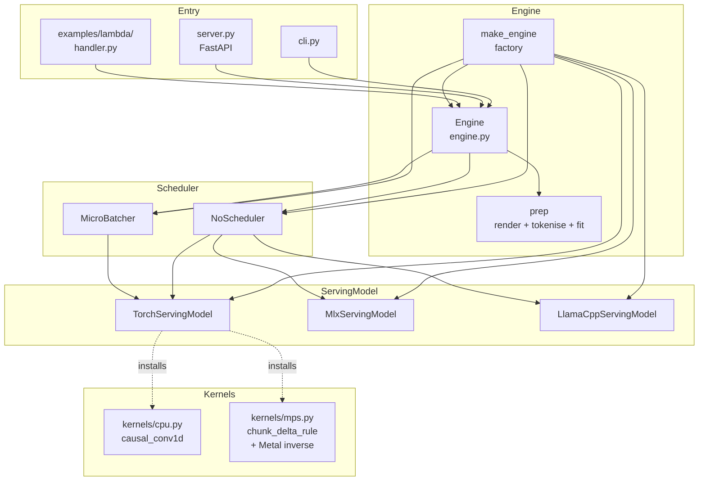
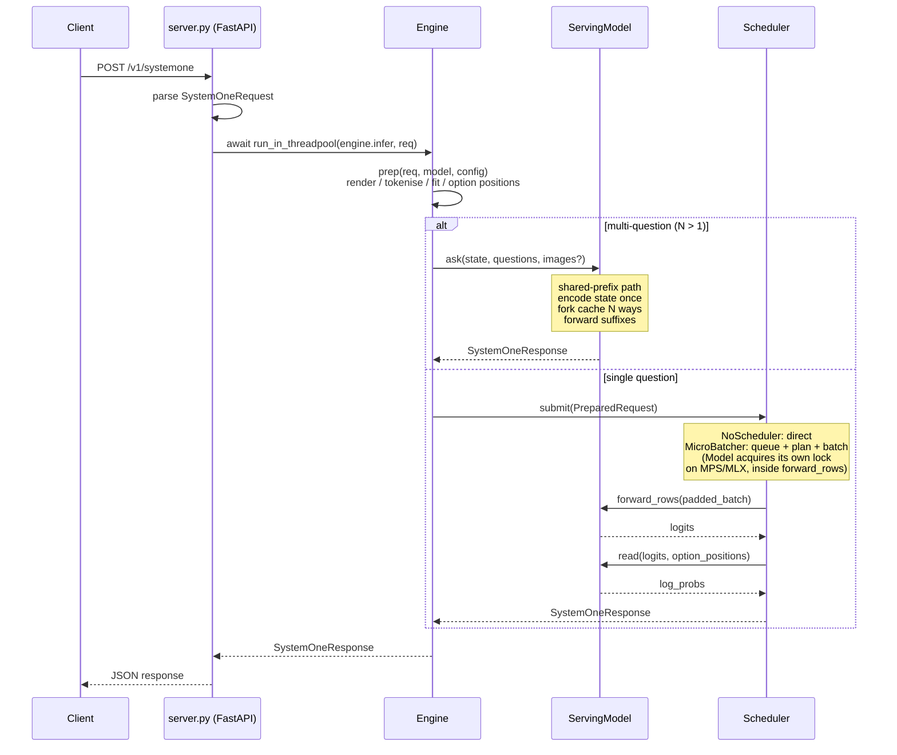
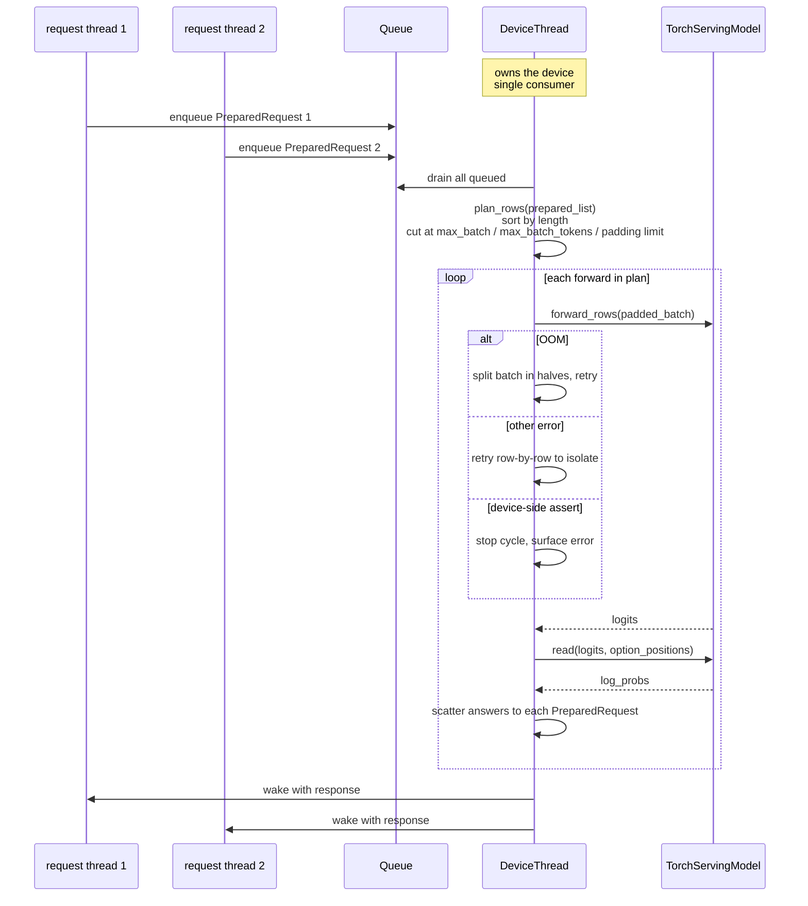

# Refactor the `src/` abstractions in `strands-decider`

## Overview

The `strands_decider` package today bundles several concerns in a few files that have grown by accretion. One file (`modeling.py`) mixes architecture, weight loading, training-only hooks, and a shared serving fast path. Another (`infer.py`) mixes KV-cache forking, engine orchestration, chunking, and response assembly. A third (`vision.py`) subclasses both using a side-channel attribute to pass image tensors through a signature that was never designed for them. A fourth (`mlx_engine.py`) subclasses the torch engine while bypassing its `__init__` because the parent assumes a torch model that MLX cannot provide.

This design reshapes the package around three named layers — **Entry**, **Engine**, **Kernels** — and establishes a `ServingModel` abstraction so that torch, MLX, and (future) a llama.cpp CPU backend can live under one interface. It also carves out a clean `Trainer`-adjacent split: a `TrainingModel` class that extends `TorchServingModel` to inherit the single implementation of the architecture, so the model that gets trained cannot structurally drift from the model that gets served.

The refactor explicitly plans for three in-flight external contributions:

- A cross-request batching feature (concurrent requests packed into shared forwards on CUDA) lands as a `Scheduler` under the Engine, not as more code in a monolithic engine file.
- An Apple-silicon Metal kernel for one specific operation lands as another dispatch under the `kernels` layer.
- A serverless Lambda deployment with a llama.cpp torso and a numpy pointer head lands as a third concrete `ServingModel`.

The result is a package where "add a kernel", "add a scheduler policy", "add a serving backend", and "serve from a new deployment surface" are each a change in one place.

## Detailed Requirements

Consolidated from the clarification pass with the user.

### Functional layering (the three-word mental model)

- **Entry** = CLI, HTTP server, Lambda handler, and any future entry layer. Takes a request shape (CLI args, HTTP body, Lambda event) and translates it to a `SystemOneRequest`, then calls `engine.infer(request)` and returns the response. The server may accept many concurrent requests; it does not do batching itself.
- **Engine** = takes one `SystemOneRequest`, preps it on the request's thread (render prompt, tokenise, fit window, locate option positions, pick kinds and temperatures), and routes it to a `Scheduler`. The Engine chooses the compute strategy; the entry layer never does.
- **Kernels** = device-specific accelerations installed into the compute path to make inference faster.

### `ServingModel` abstraction

- A `ServingModel` is a `Protocol`. Three concrete implementations:
  - `TorchServingModel` — HF transformers torso + torch pointer head, CUDA / MPS / CPU, optional vision tower, batchable.
  - `MlxServingModel` — mlx-lm torso + shared torch pointer head, Apple-silicon only, not batchable (MLX serialises on its own scheduler).
  - `LlamaCppServingModel` — llama.cpp torso via a C shim + numpy pointer head, CPU only, torch-free, not batchable. Primarily for serverless deployment where torch is too heavy.
- Modality (image support) is **composition**, not subclassing: a backend declares `handles_images = True` by holding a vision submodule or equivalent, not by being a different class.
- The checkpoint on disk is the contract between all three. Every ServingModel reads the same `strands_decider_config.json` + weights.

### `Scheduler` abstraction

- A `Scheduler` is a `Protocol`. Two concretes:
  - `NoScheduler` — one forward per request on the calling thread. CLI, Lambda, `--no-batching`, and every non-CUDA server path.
  - `MicroBatcher` — cross-request micro-batching with a queue, planner, OOM-split retry, and a startup tune. CUDA server by default.
- Backends that are not thread-safe for concurrent forwards (MPS, MLX) hold their own re-entrant lock **inside the ServingModel** (`forward_rows` and `ask` acquire it). The "needs serialising" constraint lives where the hardware constraint lives, not in a separate Scheduler class. This is the discipline today's `MLXEngine._lock` already enforces; the refactor preserves it rather than inventing a `SerialiseScheduler`.
- `Scheduler` only runs device work. CPU-only prep (prompt rendering, tokenisation, window fitting, option-position lookup) happens on the request's thread before `scheduler.submit`.
- `Engine.infer` is synchronous. Server wraps it in `run_in_threadpool`. CLI and Lambda call it directly.

### `TrainingModel` (one class, for now)

- `TrainingModel(TorchServingModel)` — class-based extension. It inherits the serving architecture (torso + pointer head + encode + forward + read) and adds training-only methods: `attach_lora`, `freeze_torso`, `trainable_parameters`, `init_from_base`, training `forward` that computes a loss, and `save_pretrained`.
- Rationale for extension over composition: training needs real torch nn.Module code with gradients, parameters, and `state_dict`; it cannot be defined against a Protocol. Inheriting the serving class is the smallest arrangement that guarantees the two share one implementation of `encode`, `forward_rows`, and `read`.
- Deferred future: a `Trainer` Protocol that composes a `TorchServingModel` and removes the inheritance; recorded as a later refactor, out of scope here.

### Anti-drift guarantees

The user explicitly asked that `TrainingModel` cannot structurally drift from any `ServingModel`. The design pins this with two complementary mechanisms:

- `TrainingModel` ↔ `TorchServingModel`: **single implementation.** The architecture code (`encode`, `forward_rows`, `read`) exists once on `TorchServingModel`. `TrainingModel` inherits it. The training `forward(batch) -> loss` is literally `self.forward_rows(...)` → `self.read(...)` → loss. Impossible to drift structurally.
- `TorchServingModel` ↔ `MlxServingModel` ↔ `LlamaCppServingModel`: **shared parts + behavioural parity.** `PointerHead` (torch nn.Module) is one class, imported by all three (MLX uses it via a torch-CPU boundary; llama.cpp uses a separate numpy implementation that is parity-tested against the torch head). `StrandsDeciderConfig` is the one architectural spec. On-disk checkpoint format is the one contract. Fidelity tests pin agreement on reference prompts.

### Layout

- `src/strands_decider/` is serving + shared primitives only.
- `training/` holds the training class, scripts, and training-only helpers; it imports from `strands_decider`, never the reverse.
- `examples/lambda/` holds the serverless deployment artefacts and uses the `LlamaCppServingModel`.

### Scope cleanup

- `SlotHead` is deleted — not used anywhere any more. `StrandsDeciderConfig.head_type` keeps the field for legacy checkpoint load but accepts only `"pointer"`; a legacy `"slot"` value raises on load with a message telling the user to use an older release.
- Related slot-head-only hooks (`init_head_from_lm_head`, the slot branches of `build_head`, references in training tests) delete with it.

### On-disk compatibility

- Head state filename stays `slot_head.pt` even for pointer heads (legacy name; preserving avoids churning published checkpoints and HF-exported artefacts). HF exports continue to produce `head.safetensors`; both filenames are read.
- `strands_decider_config.json` is primary; legacy `hobson_config.json` continues to be read.

## Architecture Overview

### Package shape

```
strands_decider/
  config.py              # StrandsDeciderConfig, file I/O, constants
  heads.py               # PointerHead (one torch nn.Module, shared)
  ops.py                 # Shared torch ops: pool_last_token, gather_options,
                         # masked_log_softmax, apply_temperature, apply_pointer_head
  torch_internals.py     # HostEmbedding, ensure_bos, cache-fork helpers,
                         # serving_attn_implementation, mlx_to_torch
  images.py              # Backend-neutral image prep (base64 decode, resize,
                         # placeholder expansion, grid token counts)
  kernels/
    __init__.py          # install_for(device) dispatcher
    cpu.py               # causal_conv1d_cpu + install()
    mps.py               # chunk_gated_delta_rule_mps + install()
                         # (PR #36's Metal _unit_lower_inverse goes here)
  model.py               # ServingModel Protocol + TorchServingModel
  mlx_model.py           # MlxServingModel (+ MLX LoRA merge, MLX torso loader)
  llamacpp_model.py      # LlamaCppServingModel (+ llama.cpp shim loader)
  engine.py              # EngineConfig, Engine, prep(), make_engine() factory,
                         # PreparedRequest, answer assembly
  scheduler.py           # Scheduler Protocol, NoScheduler, MicroBatcher,
                         # plan_rows, tune_batching
  prompting.py           # render_state, render_question, readback (read_noul,
                         # read_choice, read_score, score_legend)
  schema.py              # Pydantic wire types (unchanged)
  server.py              # FastAPI entry
  cli.py                 # typer entry

training/
  model.py               # TrainingModel(TorchServingModel), with training hooks
  train.py, evaluate.py, soup.py, hf_export.py, data/, aws/, tests/
                         # all import from strands_decider.config, .heads, .ops,
                         # .prompting, .schema, and training.model

examples/
  lambda/                # CDK stack, build scripts, Lambda handler, llama.cpp shim
```

### Layer map



### Request flow



### MicroBatcher cycle



## Components and Interfaces

### `ServingModel` Protocol

```python
class ServingModel(Protocol):
    config: StrandsDeciderConfig
    tokenizer: Any
    device: str  # "cuda" | "mps" | "cpu" | "mlx" | "llamacpp"
    handles_images: bool
    supports_batch_rows: bool

    def encode(self, text: str, images: list | None = None) -> list[int]: ...

    def forward_rows(
        self,
        padded_ids: Any,  # backend-native tensor
        attention_mask: Any,
        cache: Any | None = None,
    ) -> Any:
        """Run one padded forward. Returns backend-native hidden states.
        Caller then calls .read() with option positions."""

    def read(self, hidden: Any, option_positions: Any) -> Any:
        """Apply the pointer head. Returns per-row log probabilities as a
        structure the Engine's response assembly can consume (a torch tensor
        or a numpy array; the shape is [B, K]). The pointer head is one
        shared torch.nn.Module in torch and MLX backends."""

    def ask(
        self,
        state: Content,
        questions: dict[str, Question],
        images: list[str] | None = None,
    ) -> SystemOneResponse:
        """Shared-prefix path for a multi-question request. The ServingModel
        owns per-request KV cache logic because cache layout is backend-specific."""
```

**Design choice: the return type of `forward_rows` is backend-native.** An earlier draft specified `-> torch.Tensor`. That bakes in "head stays torch" which is true for `TorchServingModel` and `MlxServingModel` but not for `LlamaCppServingModel` whose head is numpy. Keeping the Protocol backend-neutral at the boundary lets each backend own its full numeric stack; the Engine composes the response using types coming out of `read()` which is always shaped `[B, K]` log-probs.

### `TorchServingModel`

```python
class TorchServingModel(nn.Module):
    config: StrandsDeciderConfig
    tokenizer: Any
    torso: nn.Module  # HF transformers decoder (PEFT-wrapped if use_lora)
    pointer_head: PointerHead  # shared torch nn.Module, fp32
    vision_tower: nn.Module | None  # Qwen3.5 ViT + merger, frozen; None for text-only
    device: str
    handles_images: bool  # bool(vision_tower)
    supports_batch_rows: bool = True

    def __init__(
        self, config, torso, pointer_head, tokenizer, vision_tower=None, device="cuda"
    ): ...

    @classmethod
    def load(
        cls,
        path: str,
        *,
        device: str = "cuda",
        attn_implementation: str | None = None,
        vision: bool = False,
        host_embeddings: bool | None = None,
    ) -> "TorchServingModel":
        """Read checkpoint; load torso + PointerHead + optional vision tower;
        install kernels for the chosen device; set serving attn impl for Gemma 4
        E2B when applicable; apply CPU fp32 upcast when applicable; return a
        model in eval()."""

    def encode(self, text, images=None) -> list[int]: ...

    def forward_rows(
        self,
        ids: torch.Tensor,
        mask: torch.Tensor,
        cache: Any | None = None,
        pixel_values: torch.Tensor | None = None,
        image_grid_thw: torch.Tensor | None = None,
        position_ids: torch.Tensor | None = None,
    ) -> torch.Tensor:
        """One padded forward through the torso. Vision kwargs are passed as
        kwargs on this method's signature (not via a hidden attribute).
        Position IDs are always explicit when images are involved."""

    def read(self, hidden: torch.Tensor, option_positions: torch.Tensor) -> torch.Tensor:
        """Apply pointer head via shared apply_pointer_head() from ops.py."""

    def ask(self, state, questions, images=None) -> SystemOneResponse:
        """Shared-prefix path:
        1. Prep the state + questions (window fit, option positions).
        2. Encode state once, keeping its KV cache.
        3. Fork the cache N ways via torch_internals.fork_layered_cache
           (unforkable layouts fall back to batched encoding sticky-flag).
        4. Forward suffixes.
        5. pool_last_token on the suffix (mask-aware), apply pointer head.
        6. Assemble SystemOneResponse."""
```

**Private helpers used by `load`:**
- `_load_torso(config, device, attn_implementation, vision)` — the current branching for Qwen3.5 vs Gemma 4 vs AutoModel, with the extra `vision=True` branch that keeps the Qwen3.5 ViT.
- `_install_kernels(device)` — calls into `strands_decider.kernels.cpu.install()` or `.mps.install()` as appropriate; a no-op for CUDA.

### `MlxServingModel`

```python
class MlxServingModel:
    config: StrandsDeciderConfig
    tokenizer: Any
    decoder: Any  # mlx-lm text decoder
    _lm: Any  # owning MLX module (for cache)
    pointer_head: PointerHead  # the SAME torch nn.Module as TorchServingModel
    device: str = "mlx"
    handles_images: bool = False  # future: True when MLX vision ships
    supports_batch_rows: bool = False

    @classmethod
    def load(cls, path, *, cache_limit_bytes=1 << 30) -> "MlxServingModel":
        """Read same checkpoint directory as TorchServingModel.load.
        Load torso via mlx_lm.load_model; cast dtype; merge LoRA via
        strict mlx_internals.merge_lora; load the pointer head on torch CPU."""

    def encode(self, text, images=None) -> list[int]: ...

    def forward_rows(self, ids, mask, cache=None) -> Any:
        """Pad with pad_id; mx.array; self.decoder(ids, cache=cache); mx.eval."""

    def read(self, hidden_mlx, option_positions) -> torch.Tensor:
        """Gather pooled + per-option rows on MLX, convert to torch via
        torch_internals.mlx_to_torch, call shared apply_pointer_head() with
        the same torch PointerHead object a TorchServingModel would use."""

    def ask(self, state, questions, images=None) -> SystemOneResponse:
        """MLX shared-prefix via mlx_lm.make_prompt_cache + layer.merge()."""
```

### `LlamaCppServingModel` (lands with PR #77 under this shape)

```python
class LlamaCppServingModel:
    config: StrandsDeciderConfig
    tokenizer: Any
    _lm: Any  # llama.cpp handle via C shim
    pointer_head_numpy: dict  # numpy weights for the head
    device: str = "cpu"
    handles_images: bool  # True when the mmproj vision tower is loaded
    supports_batch_rows: bool = False  # scheduler never batches it

    @classmethod
    def load(cls, path, *, vision=False) -> "LlamaCppServingModel":
        """Load Q8_0 GGUF torso via llama.cpp shim; load pointer head
        weights as numpy arrays; parity-tested against TorchServingModel on a
        reference prompt set at CI."""

    def encode(self, text, images=None) -> list[int]: ...
    def forward_rows(self, ids, mask, cache=None) -> "numpy.ndarray": ...
    def read(self, hidden_np, option_positions) -> "numpy.ndarray": ...
    def ask(self, state, questions, images=None) -> SystemOneResponse: ...
```

### `TrainingModel`

```python
# training/model.py
class TrainingModel(TorchServingModel):
    """Serving architecture + training-only hooks.

    Lives in training/ so src/strands_decider/ is serving-only. Imports from
    strands_decider.{config, heads, ops, torch_internals}."""

    @classmethod
    def from_pretrained_base(cls, config, *, device_map=None, attn_implementation=None):
        """Load the base model's torso (AutoModel; multimodal unwrapping for
        Qwen3.5 and Gemma 4), construct a fresh PointerHead, attach LoRA."""

    def attach_lora(self): ...
    def freeze_torso(self): ...
    def trainable_parameters(self) -> tuple[int, int]: ...

    def forward(self, batch) -> torch.Tensor:
        """Training forward producing a scalar loss. Internally:
            hidden = self.forward_rows(batch.ids, batch.mask)   # inherited
            logits = self.read(hidden, batch.option_positions)  # inherited
            loss   = cross_entropy_with_mask(logits, batch.labels, batch.n_slots)
        Supports soft targets (ordinal smoothing) and per-example weights."""

    def save_pretrained(self, path):
        """Writes strands_decider_config.json + slot_head.pt (legacy filename,
        contains the PointerHead state) + lora/ + tokenizer files.
        Every ServingModel.load reads this directory."""
```

### `Scheduler` Protocol and concretes

```python
class PreparedRequest(NamedTuple):
    """What the Engine produces on the request's thread, what the Scheduler consumes."""

    request_id: int
    state_ids: list[int]
    rows: list[list[int]]  # one per question
    option_positions: list[list[int]]
    kinds: list[str]
    temperatures: list[float]
    rendered: list[RenderedQuestion]
    done: threading.Event
    response_slot: list[SystemOneResponse | Exception]


class Scheduler(Protocol):
    def submit(self, prepared: PreparedRequest) -> SystemOneResponse: ...
    def health(self) -> dict: ...
    def shutdown(self) -> None: ...


class NoScheduler(Scheduler):
    """One forward per request on the caller's thread.
    If the ServingModel is thread-unsafe (MPS, MLX), its forward_rows and ask
    acquire a re-entrant lock internally — the Scheduler stays agnostic."""

    def __init__(self, model: ServingModel): ...


class MicroBatcher(Scheduler):
    """Owns a device thread; cross-request batched forwards.
    Only usable when model.supports_batch_rows is True."""

    def __init__(
        self,
        model: ServingModel,
        config: EngineConfig,
        *,
        batch_wait_ms: int = 0,
        tune: bool = True,
    ):
        self._queue = Queue()
        self._device_thread = Thread(target=self._run, daemon=True).start()
        if tune:
            self._caps = tune_batching(model, config)
```

**Model-owned serialisation for thread-unsafe backends.** `MlxServingModel` and `TorchServingModel` on MPS hold a `threading.RLock()` and wrap it around `forward_rows` and `ask`:

```python
class MlxServingModel:
    def __init__(self, ...):
        self._lock = threading.RLock()
    def forward_rows(self, ...):
        with self._lock: ...
    def ask(self, ...):
        with self._lock: ...   # reentrant — ask calls forward_rows internally
```

`TorchServingModel` constructs a no-op lock (or sets `self._lock = contextlib.nullcontext()`) when `device not in {"mps"}` so the same code path runs with zero contention on CUDA / CPU.

### `Engine`, `EngineConfig`, and `make_engine`

```python
@dataclass
class EngineConfig:
    # Model
    device: str = "cuda"
    model_name: str = "strands-decider-0.1.0"
    attn_implementation: str | None = None
    vision: bool = False
    image_long_side: int = 448
    max_images: int = 4
    max_image_pixels: int = 4096 * 4096

    # Prep
    max_length: int | None = None  # None -> model.config.max_length
    max_question_fraction: float = 0.75
    strict_window: bool = False

    # Scheduler
    batching: bool = True  # effective only on backends that support it
    batch_wait_ms: int = 0
    batch_tune: bool = True
    max_batch: int = 32
    max_batch_tokens: int | None = None

    # Shared-prefix
    use_prefix_cache: bool = True


class Engine:
    model: ServingModel
    scheduler: Scheduler
    config: EngineConfig

    def infer(self, request: SystemOneRequest) -> SystemOneResponse:
        # 1. Validate against capability flags.
        if request.images and not self.model.handles_images:
            raise ValueError("this engine has no vision tower; load with vision=True")

        # 2. Prep on this thread.
        prepared = prep(request, self.model, self.config)

        # 3. Multi-question? Model-level shared-prefix path (not scheduler).
        if len(request.questions) > 1 and self.config.use_prefix_cache:
            return self.model.ask(request.state, request.questions, images=request.images or None)

        # 4. Single row through the scheduler.
        return self.scheduler.submit(prepared)

    def health(self) -> dict:
        return {
            "model": self.config.model_name,
            "device": self.model.device,
            "handles_images": self.model.handles_images,
            "supports_batch_rows": self.model.supports_batch_rows,
            **self.scheduler.health(),
        }

    def shutdown(self) -> None:
        self.scheduler.shutdown()


def make_engine(
    checkpoint: str,
    *,
    device: str = "cuda",
    config: EngineConfig | None = None,
    deployment: Literal["server", "cli", "lambda"] = "server",
) -> Engine:
    config = config or EngineConfig(device=device)
    model = _load_model(checkpoint, device, config)
    scheduler = _pick_scheduler(model, config, deployment)
    return Engine(model, scheduler, config)


def _load_model(checkpoint, device, config) -> ServingModel:
    if device == "mlx":
        return MlxServingModel.load(checkpoint)
    if device == "llamacpp":
        return LlamaCppServingModel.load(checkpoint, vision=config.vision)
    return TorchServingModel.load(
        checkpoint,
        device=device,
        attn_implementation=config.attn_implementation,
        vision=config.vision,
        host_embeddings=None,
    )


def _pick_scheduler(model, config, deployment) -> Scheduler:
    if deployment in ("cli", "lambda"):
        return NoScheduler(model)
    # Server
    if model.supports_batch_rows and config.batching:
        return MicroBatcher(
            model, config, batch_wait_ms=config.batch_wait_ms, tune=config.batch_tune
        )
    return NoScheduler(model)
    # Thread-unsafe backends (MPS, MLX) handle their own serialisation inside
    # the ServingModel — the factory doesn't need to pick a different scheduler.
```

### `prep` function

```python
def prep(
    request: SystemOneRequest,
    model: ServingModel,
    config: EngineConfig,
) -> PreparedRequest | list[PreparedRequest]:
    """Render + tokenise + fit window + option positions. Pure CPU; runs on
    the request thread. Returns one PreparedRequest for the single-question
    scheduler path, or (for internal use by model.ask) the pieces the model
    needs for a shared-prefix forward.
    Raises ValueError (-> HTTP 422) on strict_window overflow or malformed input."""
```

### `Kernels`

```python
# strands_decider/kernels/__init__.py
def install_for(device: str) -> None:
    """Idempotent; dispatches by device. CUDA: no-op (fla / causal_conv1d
    bind at import if installed). MPS: install mps-specific kernels; add
    PR #36's specialised _unit_lower_inverse Metal kernel here. CPU: install
    causal_conv1d_cpu."""
```

The install functions preserve today's monkey-patching discipline: each one is idempotent, routes by `.device.type`, and preserves the reference impl via a closure dispatcher so other devices still reach whatever transformers bound.

## Data Models

### `StrandsDeciderConfig` (unchanged on the wire)

```python
@dataclass
class StrandsDeciderConfig:
    base_model: str = "Qwen/Qwen3-1.7B-Base"
    base_revision: str | None = None
    num_slots: int = 24  # legacy; pointer head is unbounded
    head_hidden: int = 0  # legacy; pointer head doesn't use it
    head_dropout: float = 0.0
    max_length: int = 3072
    torch_dtype: str = "bfloat16"
    head_init: str = "random"  # legacy; pointer head doesn't use "lm_head"
    kl_frozen_weight: float = 0.0
    head_type: str = "pointer"  # only "pointer" is valid post-refactor;
    # legacy "slot" raises
    pointer_dim: int = 256
    temperature: float = 1.0
    temperature_by_kind: dict[str, float] = field(default_factory=dict)
    ordinal_smoothing: float = 0.0
    use_lora: bool = True
    lora_r: int = 16
    lora_alpha: int = 32
    lora_dropout: float = 0.05
    lora_targets: list[str] = field(
        default_factory=lambda: [
            "q_proj",
            "k_proj",
            "v_proj",
            "o_proj",
            "gate_proj",
            "up_proj",
            "down_proj",
        ]
    )
    force_bos: bool = False
    host_embeddings: bool = False
```

Legacy fields are retained for config-file compatibility; the loader rejects `head_type != "pointer"`.

### `PreparedRequest`

Already shown above. The request-level unit the Scheduler consumes.

### Wire types

Unchanged from today. `SystemOneRequest(state, questions, images, model)`, `Question` union (`NoulQuestion | ChoiceQuestion | ScoreQuestion`), `Answer` union, `SystemOneResponse(model, answers, usage)`. All Pydantic.

### On-disk checkpoint

```
<checkpoint_dir>/
    strands_decider_config.json         # or legacy hobson_config.json
    slot_head.pt                        # legacy filename; holds PointerHead state
                                        # (HF export writes head.safetensors instead)
    lora/
        adapter_config.json
        adapter_model.safetensors
    tokenizer.json, tokenizer_config.json, special_tokens_map.json, ...
    provenance.json                     # optional; records base model revision
```

All three ServingModels read this directory. `TrainingModel.save_pretrained` writes it.

## Error Handling

### Where each kind of failure surfaces

| Failure | Where it raises | What the user sees |
|---|---|---|
| Over-window prompt with `strict_window` | `prep()` on the request thread | HTTP 422 with "prompt of N tokens exceeds the context window of M tokens" |
| Image with text-only model | `Engine.infer` capability check | HTTP 422 with "this engine has no vision tower; serve with --vision for images" |
| Images decode failure (bad base64 / huge pixels / unsupported format) | `prep()` via `images.decode_image` | HTTP 422 with a specific reason |
| Choice option count exceeds `num_slots` (legacy slot-head path only; dead post-cleanup) | `prep()` | HTTP 422 |
| CUDA OOM in a shared forward | `MicroBatcher`: split in halves and retry; a row that fails alone surfaces its OOM | HTTP 500 for the offending request; other rows in the batch complete normally |
| Other error inside a shared forward | `MicroBatcher`: retry row-by-row to isolate | HTTP 500 for the offending row only |
| Device-side assert (CUDA lost context) | `MicroBatcher`: stop launching more work; next request gets a plain error | HTTP 500 and operator sees batcher-stopped in `/health` |
| `UnforkableCache` on the shared-prefix path | `TorchServingModel.ask`: set sticky `_prefix_cache_unforkable` flag, fall back to batched encoding | Transparent; one log line on first occurrence |
| MLX LoRA merge sees an unsupported adapter | `MlxServingModel.load` | Startup fails with specific unsupported-flag names |
| Checkpoint missing `lora/` while `use_lora=True` | `ServingModel.load` | Startup fails with path and reason (no silent base-weights fallback) |
| Tokeniser race ("Already borrowed") | `_tok_lock` on each ServingModel | Prevented structurally — HF fast tokenisers run under a per-model lock |

### Error-isolation invariants

- A refused request **never** touches the device thread.
- One request's OOM does not cancel other rows in the same cycle.
- A device-side assert stops subsequent cycles rather than silently continuing on a corrupted stream.
- Multi-question requests take the shared-prefix path and run alone on the device thread — never share a forward with another request's rows.

## Testing Strategy

### Keep every existing test green

The migration is sequenced (see Appendix: Migration Plan) so that after each step the whole test suite passes. The sensitive tests are:

- `tests/test_prefix_cache.py` — shared-prefix path matches batched path to float tolerance for plain and hybrid torsos.
- `tests/test_batch_tokens.py` — `max_batch_tokens` chunking.
- `tests/test_engine_concurrency.py` — tokeniser lock + engine concurrency.
- `tests/test_mlx_engine.py` — MLX LoRA merge fidelity + 54-answer parity against torch.
- `tests/test_mps_kernels.py`, `tests/test_cpu_kernels.py` — kernel dispatch and correctness (including PR #36's `_unit_lower_inverse` ill-conditioned regression case).
- `tests/test_vision.py` — image path end-to-end, including text requests under a vision-capable server.
- `tests/test_hybrid.py`, `tests/test_gemma4.py`, `tests/test_serving_attn.py` — torso-specific wiring (Gated DeltaNet, Gemma 4 attn selection).
- `tests/test_hf_export.py`, `tests/test_checkpoint_load.py` — HF export + checkpoint load.
- `tests/test_server.py` — HTTP integration.
- `training/tests/*` — training end-to-end.

### Add two new tests

- `tests/test_training_serving_parity.py` — build a `TrainingModel` on a tiny config, `save_pretrained`, load as `TorchServingModel`, assert bit-identical logits on the same inputs. Confirms the "single implementation" guarantee holds across the checkpoint round trip. Added in the step where `TrainingModel` splits out from `strands_decider.modeling`.
- `tests/test_backend_parity.py` — on reference prompts, assert `TorchServingModel`, `MlxServingModel` (where available), and `LlamaCppServingModel` (where available) produce answers that agree within documented float tolerances. Formalises the per-backend fidelity work that PRs #77 and today's MLX engine already do.

### Capability-based test skipping

Tests use `pytest.importorskip` and host capability checks (`torch.cuda.is_available`, `platform.machine() == "arm64"`, `llama_cpp` import) to self-skip when the hardware is absent. No test requires all three backends on one host.

### Design-doc-level smoke test checklist

Before merging the final cleanup (Step J), confirm:

- A CUDA server with batching enabled serves PR #88's reference workload at the throughput PR #88 published, within 5%.
- An MPS server with the Metal `_unit_lower_inverse` kernel from PR #36 shows the same 1.15× full-model speedup PR #36 published.
- A Lambda deployment of PR #77's `LlamaCppServingModel` answers within the published latencies at the published cost.
- `pytest -q` passes locally, on CI, on CUDA, on MPS, and on arm64 macOS with MLX.

## Appendices

### Appendix A — Technology Choices and Rationales

| Choice | What was considered | Why we picked it |
|---|---|---|
| `ServingModel` as a `Protocol` rather than ABC | ABC with abstract methods; Keras-3-style unified backend; just three sibling classes with no shared interface | Protocol gives structural typing without forcing inheritance. The three backends share no implementation (torch, MLX, numpy); an ABC would be empty methods, i.e. a Protocol in a trench coat. Keras-3-style unification would require rewriting the architecture against a neutral op set, losing access to fla / causal_conv1d / mlx-lm kernels — too much cost for too little gain. |
| Backend × Scheduler as the two axes; modality via composition | Three axes (Backend × Modality × Scheduler); modality as subclass; one axis with everything in a monolithic engine | Vision today is text-only MLX is text-only; three axes creates a 2×2×3=12 class matrix mostly empty. Composition (optional `vision_tower` submodule) keeps the backend count at three and matches the engine's "backend knows the compute architecture" story. Scheduler stays separate because batching strategy is orthogonal to compute backend. |
| `TrainingModel(TorchServingModel)` extension; defer `Trainer` composition | Compose a Trainer around a ServingModel; one unified class with runtime-mode flags | Extension is the minimum arrangement that guarantees single-implementation of the architecture (which is what prevents drift). Composition is architecturally cleaner but adds a layer with no immediate payoff — deferred as a later refactor. The user's explicit decision in A6. |
| Sync `Engine.infer` with threadpool wrap in the server | Async-first `Engine.infer -> awaitable`; sync + run_in_threadpool | Every current entry (CLI, Lambda, FastAPI with run_in_threadpool) is natively sync. Async leaks machinery into Engine/Scheduler/tests for no stated benefit. If one process ever needs to serve thousands of concurrent connections, swap to futures without API break. |
| Head stays torch in `MlxServingModel` (via buffer-protocol conversion of pooled hidden states) | Port `PointerHead` to MLX; keep torch head with per-row conversion | Portion of hidden states that cross the boundary is a few rows × dim fp32 bytes — cheap. Keeping one `PointerHead` nn.Module shared across torch and MLX is the strongest anti-drift guarantee available. MLX training is not on the roadmap; the moment it is, the ServingModel Protocol loosens and a mirror `MlxPointerHead` ports. |
| `MicroBatcher` lives in `scheduler.py`, not inside the ServingModel | Batcher as a ServingModel internal; batcher as an engine-level concern | PR #88's `MicroBatcher` is cross-request orchestration — its logic (queue, planner, OOM retry, tune) depends on backend only through `supports_batch_rows` and `forward_rows`. It is a sibling of `NoScheduler`, not a backend internal. |
| Two Schedulers (NoScheduler, MicroBatcher); model-owned lock for thread-unsafe backends | Three Schedulers including `SerialiseScheduler` for MPS/MLX | A `SerialiseScheduler` would differ from `NoScheduler` by one lock. Moving the lock onto the ServingModel that needs it collocates the "requires serialising" constraint with the hardware fact that imposes it, drops one class, and matches today's `MLXEngine._lock` discipline. |
| Flat `kernels/` subpackage over flat `cpu_kernels.py` + `mps_kernels.py` | Flat today; subpackage after refactor | Subpackage anticipates PR #36 adding a specialised Metal kernel and future CUDA accelerators. Low churn — the install functions keep their contract. |
| Layout (L1): `TrainingModel` lives in `training/`, imports from `strands_decider` | L1 (training outside package); L2 (training stays in src) | The package already states (CLI docstring, PR #96) that training lives outside. Completing the direction gives `src/strands_decider/` a serving-only story. One-time import rewrite in `training/*.py`. |
| Delete `SlotHead` entirely | Keep for legacy checkpoint loading | User confirmed slot head isn't used. Legacy loading still works via a config-level check that raises on `head_type == "slot"` with a message pointing to an older release. |
| On-disk filename `slot_head.pt` retained for pointer heads | Rename to `pointer_head.pt`; keep legacy name | Published checkpoints and HF exports use `slot_head.pt`; renaming would churn consumers for no end-user benefit. HF exports keep writing `head.safetensors`; both filenames are read. |

### Appendix B — Research Findings (summarised)

The current `src/strands_decider/` layout (3,225 LOC across 11 modules, as of 2026-10-20) was walked file-by-file. The salient findings for this design:

**`infer.py` (575 LOC).** Mixes KV-cache forking logic (transformers-5 layered-cache, DeltaNet-aware fork via explicit field copies), `EngineConfig`, `SystemOneEngine` (which handles rendering, tokenisation, window-fitting, chunking, both shared-prefix and batched paths, answer assembly), and the `load_engine` / `mlx_available` / `load_mlx` factory. The batched serving path **already routes through `StrandsDeciderModel.forward`** — i.e. the training forward is also the serving forward for the single-row path, which is the single-implementation win this refactor broadens. The shared-prefix path diverges and inlines head application; this design unifies them by routing through `TorchServingModel.read`.

**`modeling.py` (746 LOC).** `StrandsDeciderConfig` + four shared ops (`pool_last_token`, `gather_options`, `masked_log_softmax`, `apply_temperature`) + `PointerHead` + `SlotHead` + `HostEmbedding` + `StrandsDeciderModel` (325 LOC) that bundles config, torso loading (with Qwen3.5 / Gemma 4 multimodal unwrapping), LoRA attachment, training forward (with soft-targets and per-example weights), checkpoint I/O (including the `__init__`-bypass trick that works around double-LoRA-attach), the frozen-slot readout, and the LM-head seeding. The `__init__` bypass is a direct consequence of today's class mixing serving and training; splitting them removes the hack.

**`vision.py` (575 LOC).** Image prep (base64 → PIL → size-cap → resize → RGB, token-count helpers from grid dims, placeholder expansion), `VisionDeciderModel(StrandsDeciderModel)` that keeps the Qwen3.5 ViT and overrides enough methods to inject images, and `VisionEngine(SystemOneEngine)` with explicit M-RoPE handling. Two structural artefacts here are symptomatic rather than fundamental: (a) a hidden `_mm` class attribute to pass `(pixel_values, image_grid_thw)` through the parent's forward signature; (b) a `_reset_positions` method that clears `torso.rope_deltas` before every request because transformers stores it between calls. The composition shape in this design removes both by passing images through `forward_rows` kwargs and always passing positions explicitly.

**`mlx_engine.py` (278 LOC).** Subclasses `SystemOneEngine` while bypassing `__init__` because the parent moves a torch model to a torch device. Holds a `_Readout` object (config + tokenizer + head) in place of a `StrandsDeciderModel`. Does its own cache fork via `type(layer).merge([layer] * n)` — a cleaner mechanism than the manual `_fork_layered_cache` on the torch side. Head stays torch, running fp32 on CPU; MLX fp32 hidden states cross the boundary via `torch.frombuffer(bytearray(memoryview(mlx_array)), dtype=torch.float32)`. Includes a strict `merge_lora` that refuses non-plain LoRA adapters (DoRA, embedding/bias LoRA, rank/alpha patterns) rather than silently skipping — this strictness is a correctness feature and the design preserves it.

**`cpu_kernels.py` (93 LOC), `mps_kernels.py` (195 LOC).** Both monkey-patch `transformers.models.qwen3_5.modeling_qwen3_5`. CPU replaces per-channel `_slow_conv2d_forward` with a channel-last depthwise manual conv (6,144 channels × 18 layers = 110,592 fn calls → one tensor op). MPS replaces `torch.linalg.solve_triangular` with a recursive block inversion applied twice (avoids an earlier Neumann-product approach that was wrong by up to 5e8 on real activations). Dispatchers preserve non-matching devices unchanged. PR #36 adds a specialised Metal `_unit_lower_inverse` kernel in the MPS file.

**`prompting.py` (187 LOC), `schema.py` (198 LOC).** Backend-neutral, no torch. Deterministic JSON rendering so shared-prefix cache is sound. Pydantic wire types matching the public Jev API. PR #77 has already moved related readouts into `prompting.py` — the refactor keeps this direction.

**PR #88 (`feat(serve): batch concurrent requests`).** Adds `MicroBatcher` (325 LOC in `infer.py`, 141 LOC in `server.py`), startup `tune_batching`, OOM-split retry, lost-context stop, planner (`plan_rows` with padding and quadratic caps), and CLI flags. On an L40S with 32 concurrent 2B-qwen3.5 requests at 256-token prompts, measures 49.1 decisions/s against main's 6.4. Multi-question requests opt out and run alone; MLX / vision opt out via `can_batch_rows() = False`. Under this design, `MicroBatcher` is a `Scheduler` concrete; all of its logic lives in `scheduler.py`; `_forward_rows` becomes `TorchServingModel.forward_rows`.

**PR #36 (`perf: optimize MPS unit lower inverse`).** +75 LOC in `mps_kernels.py`: a specialised Metal kernel for `_unit_lower_inverse` restricted to `fp32`, `64×64`, MPS. 2.78× speedup on the kernel, 1.15× on full-model inference on M2 Max. All other shapes/dtypes/devices continue to use the existing PyTorch path. Under this design, lands as another dispatch in `kernels/mps.py` with the exact same shape predicate.

**PR #77 (`feat(examples): serve the 2B decider serverless on AWS Lambda`).** +322 LOC `hidden_engine.py` (llama.cpp torso + numpy pointer head, torch-free), +176 LOC `images.py` (extracted torch-free image prep used by both the torch vision engine and the Lambda engine), new deployment stack in `examples/lambda/` (CDK + Lambda handler + llama.cpp C shim). Peak 5.9 GB on a 10 GB arm64 Lambda; ~$0.0006-$0.0009 per request at 500 tokens with three questions. Already heading in the direction of this refactor (shared `images.py`, slimmer `vision.py` and `infer.py`). Under this design, `hidden_engine` becomes `LlamaCppServingModel(ServingModel)`; the Protocol is backend-neutral at the boundary so no torch is pulled in on the Lambda.

**Training coupling.** ~15 files under `training/` and ~15 under `tests/` import from `strands_decider.modeling` (StrandsDeciderConfig, StrandsDeciderModel, SlotHead, PointerHead, HostEmbedding, pool_last_token, masked_log_softmax, apply_temperature, gather_options, MASK_VALUE, CONFIG_NAME, LEGACY_CONFIG_NAME, config_path, base_revision, checkpoint_dir, load_head_state, ensure_bos, serving_attn_implementation). All move to one of `strands_decider.{config, heads, ops, torch_internals}` or (for `StrandsDeciderModel`) to `training.model.TrainingModel`. During migration, `strands_decider.modeling` becomes a re-export shim for one release so external consumers don't break mid-flight; the shim is deleted in the final cleanup step.

### Appendix C — Alternative Approaches Considered

**Alt 1: Backend-neutral architecture spec.** Define the forward in a neutral op set (Keras 3, Ivy, or a bespoke primitive protocol). Both torch and MLX execute the same code. Rejected: the torsos (Qwen3.5 Gated DeltaNet, Gemma 4 sliding window, Gemma 4 per-layer embeddings) use library-specific optimised layers that are not available in any neutral op set we could adopt. The cost of hand-rolling a neutral IR exceeds the benefit for a two-backend codebase.

**Alt 2: Torch-to-MLX auto-translator.** Write a transformer that walks the torch module tree at load time and constructs the MLX equivalent. No parallel implementation to drift against. Rejected for now: non-trivial to implement for hybrid torsos (DeltaNet, M-RoPE); loses the mlx-lm fused kernel wins; "head stays torch" shared-nn.Module anti-drift is already sufficient for the STRANDS-authored piece.

**Alt 3: Collapse Model and Backend into one concept.** No separate `Backend` abstraction; the ServingModel owns weights, device, cache ops, forward. Adopted — this is in fact the design. The three-axis alternative (Backend × Modality × Scheduler) was rejected as overkill for two live backends.

**Alt 4: `Engine.infer -> awaitable[response]`.** Async-first API that returns futures from the scheduler. Rejected for the sync-first design because every current entry (CLI, Lambda, FastAPI with `run_in_threadpool`) is naturally sync, and no scaling goal requires leaking asyncio into the Engine/Scheduler/model tests.

**Alt 5: `TrainingModel` composes a `TorchServingModel` via a `Trainer` wrapper.** Structurally cleaner — training is a process, not a kind of model. Deferred (not rejected): class-based extension is the minimum move today, and the user explicitly chose to defer the Trainer refactor.

**Alt 6: Keep today's layered shape, just document it better.** Change nothing structurally; add a README that explains how pieces fit. Rejected as insufficient: the user's premise — "the abstractions aren't legible to begin with" — is a code-shape problem, not a documentation gap. PR #88, #77, and #36 each struggle against the current layering in ways documentation alone will not fix.

### Appendix D — Migration Plan (summarised)

Ten steps, each independently reviewable and shippable, test suite green at every boundary:

A. Delete `SlotHead` and slot-head-only hooks (~-50 to -80 LOC).

B. Extract shared primitives into `config.py`, `heads.py`, `ops.py`, `torch_internals.py` — pure moves, with re-exports from `strands_decider.modeling`.

C. Introduce `strands_decider.model` with `ServingModel` Protocol and `TorchServingModel`. `StrandsDeciderModel` subclasses the new serving class temporarily, carrying training hooks.

D. Introduce `strands_decider.engine` and `strands_decider.scheduler`. `Engine` + `make_engine` + `NoScheduler`. Entry layers begin calling `Engine`. `TorchServingModel` on MPS acquires its own `threading.RLock()` inside `forward_rows` / `ask`.

E. Introduce `strands_decider.mlx_model` with `MlxServingModel`. `make_engine(device="mlx")` wires it with `NoScheduler`; the model's internal lock serialises forwards (same discipline today's `MLXEngine._lock` enforces). Delete the subclass-with-no-super init.

F. Move `TrainingModel` to `training/model.py`; delete `StrandsDeciderModel` from `src/`. Rewrite `training/*.py` imports. Add `test_training_serving_parity.py`.

G. Vision becomes composition: optional `vision_tower` submodule on `TorchServingModel`. Delete `VisionDeciderModel` / `VisionEngine`; delete the `_mm` side channel; delete `_reset_positions`.

H. Add `MicroBatcher` (lands PR #88's logic under the new structure). CUDA server flips to batched by default.

I. Add `LlamaCppServingModel` (lands PR #77's `hidden_engine` under the new structure). Lambda example wires `make_engine(device="llamacpp") + NoScheduler`.

J. Delete re-export shims (`strands_decider.modeling`, `strands_decider.infer`, `strands_decider.vision`, `strands_decider.mlx_engine`). Update docs.

If PR #88 or PR #77 merges before this refactor begins, steps H / I become code moves rather than feature ports. If PR #36 merges earlier, it lands in whatever shape `mps_kernels.py` has at that point and moves with the kernel subpackage in step B. Any ordering between the external PRs and this refactor is reconcilable; the design does not depend on a particular interleaving.
